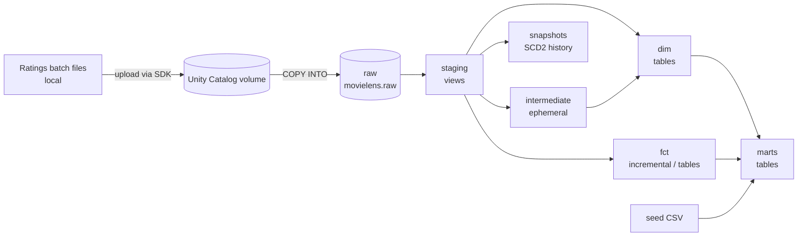

# MovieLens Lakehouse

An end-to-end ELT project on **Databricks (Unity Catalog)** with **dbt** and **Airflow**. It takes the raw MovieLens 20M ratings data through a layered model (staging, dimensions, facts, marts), tracks history with snapshots, validates it with tests and freshness checks, and runs on a simulated daily batch schedule. Pull requests are built and tested by GitHub Actions.

It runs on **Databricks Free Edition** with Airflow running locally in Docker. The data is a public dataset and the batches are simulated, so this is a learning and portfolio project, not production.

## Architecture



<!-- TODO: add screenshots, e.g.


-->

| Layer | Location | Materialization | Purpose |
|---|---|---|---|
| Raw | `movielens.raw` | Delta tables | CSV data loaded as-is with `COPY INTO`; ratings also carry `_loaded_at` and `_source_file` load metadata |
| Staging | `<target>` schema | Views | Rename columns, fix types, convert Unix timestamps |
| Intermediate | `<target>` schema | Ephemeral | Reusable joins, injected as CTEs and never stored |
| Dim | `<target>` schema | Tables | Movies, users, genome tags, movies with tags |
| Fct | `<target>` schema | Table / incremental | Ratings (incremental), genome scores |
| Marts | `<target>` schema | Tables | Consumer-facing models, e.g. ratings enriched with release dates |
| Snapshots | `<target>_snapshots` | Tables | Type 2 history for movies and tags |

`<target>` is `dev` for local work, `ci_pr_<number>` for pull requests, and `prod` for scheduled runs.

<!-- TODO: check the intermediate and mart materializations match dbt_project.yml -->

## Tech stack

- **Databricks** (Unity Catalog, volumes, SQL warehouse)
- **dbt-databricks** for transformations, tests, snapshots, seeds and macros
- **Airflow** (Astro CLI, Docker) with **Astronomer Cosmos** to run dbt as Airflow tasks
- **Databricks SDK** for file uploads to the volume
- **GitHub Actions** for CI

## Orchestration

One DAG run processes one batch of ratings. The 20M-row ratings file is sorted by timestamp and split into about 20 batch files, so every batch is strictly newer than the previous one. That is what lets the incremental model and the snapshots behave realistically.

```
pick_batch → upload_batch → load_batch → dbt_build (Cosmos task group)
                                 └──────→ advance_pointer
```

1. **`pick_batch`** reads a counter (an Airflow Variable) and chooses the next batch file. When no batches are left, the run is skipped.
2. **`upload_batch`** uploads the file to a Unity Catalog volume with the Databricks SDK.
3. **`load_batch`** runs `COPY INTO` for that single file and records the load time and source file name.
4. **`dbt_build`** runs the whole dbt project against `prod`, one Airflow task per model and test.
5. **`advance_pointer`** moves the counter forward only after a successful load, so a failed run retries the same batch. `COPY INTO` remembers which files it has loaded, so a retry cannot load a batch twice.

### How this maps to a production platform

| In this project | In a real platform |
|---|---|
| A script splits a file into batches | Source systems or other pipelines drop files or events into cloud storage |
| The DAG uploads the file to the volume | Files are already in storage, so Airflow only triggers the load |
| `COPY INTO` for a single file | `COPY INTO` or Auto Loader, which discovers new files by itself |
| Manual trigger | A schedule, or an event such as "file arrived" |
| dbt runs on the Airflow worker through Cosmos | Often a Databricks Job, triggered and monitored by Airflow |
| Airflow in Docker on a laptop | Managed Airflow (for example MWAA or Astronomer) |
| A personal access token in a local `.env` | A service principal, with secrets in a secrets manager |

This is batch processing, not streaming.

## dbt project

- **Sources and staging:** raw tables declared in `sources.yml`, one staging model per source, with a custom macro for Unix timestamp conversion.
- **Incremental model:** `fct_ratings` only processes rows newer than the current maximum timestamp.
- **Snapshots:** `snap_movies` (check strategy) and `snap_tags` (timestamp strategy with hard-delete invalidation), keyed with surrogate keys from `dbt_utils`.
- **Seeds:** a small movie release date file, joined into the marts layer.
- **Macros and analyses:** reusable SQL helpers, plus ad hoc analysis queries that are compiled but never materialized.
- **Packages:** `dbt_utils`, installed with `dbt deps`.

## Data quality

- **Generic tests:** `unique`, `not_null`, `relationships` and `accepted_values` on dims and facts.
- **Stronger checks with `dbt_utils`:** a unique (user, movie) combination on ratings (which would catch a batch loaded twice), a row-count reconciliation against staging, and a rating range check.
- **Custom tests and singular tests** for rules that do not fit the built-ins.
- **Source freshness:** based on the `_loaded_at` column added at load time, because the ratings' own timestamps are from the 1990s and say nothing about pipeline health.
- **Severity is deliberate:** `error` for keys and duplicates, `warn` for checks worth watching that should not block the pipeline.

## Design decisions

- **Views for staging, tables for dims, facts and marts.** Staging is cheap and should always reflect the raw data, while downstream layers are queried often.
- **Incremental ratings with sorted batches.** A timestamp filter can skip late-arriving rows, so the batches are sorted and cut only at timestamp boundaries.
- **Snapshots built from staging models,** with the key created upstream, because YAML-style snapshots cannot contain custom SQL.
- **Separate schemas per environment,** so CI and scheduled runs never touch each other's data.
- **Progress is tracked at load time,** not at the end of the dbt run. Loading is the unit of progress, and the dbt models are idempotent and incremental, so a failed dbt run catches up on the next run.
- **Cosmos asset emission is turned off,** because the Databricks asset URI validation rejected the URIs Cosmos generated for some models. Task dependencies work without it.
- **Personal access tokens,** because Free Edition may not support service principals. On a full workspace I would use an OAuth service principal.

## CI

On every pull request touching `dbt/**`, GitHub Actions installs the pinned dependencies, runs `dbt deps`, and runs `dbt build --target ci`, which covers seeds, models, snapshots and tests. Each pull request builds into its own `ci_pr_<number>` schema. Credentials come from GitHub secrets and are read through environment variables.

## Running it yourself

**Prerequisites:** a Databricks workspace with a running SQL warehouse, Python 3.12, Docker, the [Astro CLI](https://www.astronomer.io/docs/astro/cli/overview), and the MovieLens 20M dataset.

1. **Create the objects and raw tables** in Databricks.
   ```sql
   CREATE CATALOG IF NOT EXISTS movielens;
   CREATE SCHEMA IF NOT EXISTS movielens.raw;
   CREATE VOLUME IF NOT EXISTS movielens.raw.netflixstage;
   ```
   The table definitions and load statements are in `<!-- TODO: path, e.g. sql/01_load_raw.sql -->`.
2. **Prepare the ratings batches** by sorting `ratings.csv` by timestamp and splitting it at timestamp boundaries: `<!-- TODO: scripts/split_ratings.py -->`. Output goes to `airflow/include/data/ratings_batches/`, which is not committed.
3. **Set up dbt**
   ```bash
   python3.12 -m venv .venv
   source .venv/bin/activate
   pip install -r requirements.txt
   cd dbt && dbt deps && dbt build
   ```
   This needs a `dev` profile in `~/.dbt/profiles.yml` (see `dbt/ci/profiles.yml` for the shape).
4. **Run Airflow**
   ```bash
   cd airflow
   astro dev start
   ```
   Put the Databricks connection and SQL warehouse path in `airflow/.env` (not committed), then open `http://localhost:8080` and trigger `movielens_pipeline`.

## Not included

Left out on purpose to keep the scope focused:

- **Infrastructure as code** (Terraform), which I cover in a separate project on AWS.
- **Observability and anomaly monitoring,** which I plan to cover in a streaming project.
- **Streaming ingestion** (Auto Loader or Structured Streaming).
- **Slim CI,** which builds only changed models.

## Repository layout

```
.
├── airflow/          Airflow project (DAGs, Dockerfile, requirements)
├── dbt/              dbt project (models, snapshots, seeds, macros, tests, analyses)
│   └── ci/           profiles used by CI (environment variables only, no secrets)
├── .github/workflows/dbt-ci.yml
└── requirements.txt
```

## Data

[MovieLens 20M](https://grouplens.org/datasets/movielens/) from GroupLens Research. Please follow the dataset's license and citation terms if you reuse it.