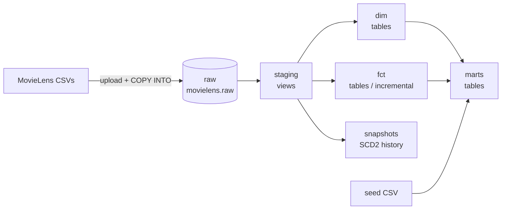

# MovieLens Lakehouse

An analytics engineering project on **Databricks (Unity Catalog)** using **dbt**, with CI on GitHub Actions. It takes the raw MovieLens CSV files through a layered model (staging, dimensions, facts, marts), adds history tracking with snapshots, and validates everything with dbt tests.

It runs on **Databricks Free Edition**. The data is a public dataset, and this is a personal learning project, not production.

> **Status:** dbt layer and CI are done. Airflow and a data quality layer are on the [roadmap](#roadmap).

## Architecture



| Layer | Location | Materialization | Purpose |
|---|---|---|---|
| Raw | `movielens.raw` | Delta tables | Source CSVs loaded as-is with `COPY INTO` from a Unity Catalog volume |
| Staging | `movielens.dev` | Views | Rename columns, fix types, convert Unix timestamps |
| Intermediate | `movielens.dev` | Ephemeral | Reusable joins, injected as CTEs and never stored |
| Dim | `movielens.dev` | Tables | Movies, users, genome tags, movies with tags |
| Fct | `movielens.dev` | Table / incremental | Ratings (incremental), genome scores |
| Marts | `movielens.dev` | Tables | Consumer-facing models, e.g. ratings enriched with release dates |
| Snapshots | `movielens.dev_snapshots` | Tables | Type 2 history for movies and tags |

<!-- TODO: check the intermediate and mart materializations match dbt_project.yml -->

## Tech stack

- **Databricks** with Unity Catalog (catalog, schemas, volumes) and a SQL warehouse
- **dbt-databricks** for transformations, tests, snapshots, seeds and macros
- **GitHub Actions** for CI
- Planned: Terraform, Airflow (local), a data quality layer

## What's in the dbt project

- **Sources and staging:** raw tables declared in `sources.yml`, one staging model per source, with a custom macro for Unix timestamp conversion.
- **Incremental model:** `fct_ratings` only processes rows newer than the current maximum timestamp.
- **Snapshots:** `snap_movies` (check strategy) and `snap_tags` (timestamp strategy with hard-delete invalidation), both keyed with surrogate keys from `dbt_utils`.
- **Seeds:** a small movie release date file, joined into the marts layer.
- **Tests:** generic tests (`unique`, `not_null`, `relationships`, `accepted_values`), a custom generic test, and singular tests, all run by `dbt build`.
- **Macros and analyses:** reusable SQL helpers, plus ad hoc analysis queries that are compiled but never materialized.
- **Packages:** `dbt_utils`, installed with `dbt deps`.

## Design decisions

- **Views for staging, tables for dims, facts and marts.** Staging is cheap and should always reflect the raw data. Downstream layers are queried often, so they are stored.
- **Incremental for ratings.** Ratings are immutable events and the largest table, so appending only new rows is much cheaper than a full rebuild. The known limitation is that a timestamp filter can miss late-arriving rows.
- **Snapshots from staging models,** with the key built in an upstream model, because YAML-style snapshots cannot hold custom SQL.
- **Separate schema per environment.** Local work goes to `dev`, pull requests to `ci_pr_<number>`, and a `prod` target exists for scheduled runs later.
- **Personal access token for CI.** Free Edition may not support service principals, so the workflow uses a token stored as a GitHub secret. On a full workspace I would use an OAuth service principal.

## CI

On every pull request touching `dbt/**`, GitHub Actions:

1. installs Python and the pinned dependencies,
2. runs `dbt deps`,
3. runs `dbt build --target ci`, which covers seeds, models, snapshots and tests.

Each pull request builds into its own schema, so CI never touches `dev` or `prod`. Credentials come from GitHub secrets and are read through environment variables.

## Running it yourself

**Prerequisites:** a Databricks workspace, a running SQL warehouse, Python 3.12, and a personal access token.

1. **Create the objects**
   ```sql
   CREATE CATALOG IF NOT EXISTS movielens;
   CREATE SCHEMA IF NOT EXISTS movielens.raw;
   CREATE VOLUME IF NOT EXISTS movielens.raw.netflixstage;
   ```
2. **Load the raw data.** Upload the MovieLens CSVs to the volume, create the `raw_*` tables, and load them with `COPY INTO`. The scripts are in `<!-- TODO: add path, e.g. sql/ -->`.
3. **Set up dbt**
   ```bash
   python3.12 -m venv .venv
   source .venv/bin/activate
   pip install -r requirements.txt
   cd dbt
   dbt deps
   ```
4. **Configure `~/.dbt/profiles.yml`** with host, HTTP path, token, `catalog: movielens` and `schema: dev` (see `dbt/ci/profiles.yml` for the shape, which reads from environment variables).
5. **Build everything**
   ```bash
   dbt build
   ```

## Roadmap

- [x] dbt models, snapshots, seeds, tests, macros
- [x] Git repository and CI on pull requests
- [x] Airflow (local) orchestrating ingestion, `dbt build` and snapshots
- [ ] Data quality: source freshness, extra dbt tests, anomaly detection, a results dashboard
- [ ] Slim CI (build only changed models) and automatic cleanup of CI schemas

## Repository layout

```
.
├── dbt/              dbt project (models, snapshots, seeds, macros, tests, analyses)
│   └── ci/           profiles used by CI (environment variables only, no secrets)
├── airflow/          planned
├── .github/workflows/dbt-ci.yml
└── requirements.txt
```

## Data

[MovieLens](https://grouplens.org/datasets/movielens/) from GroupLens Research. Please follow the dataset's license and citation terms if you reuse it.